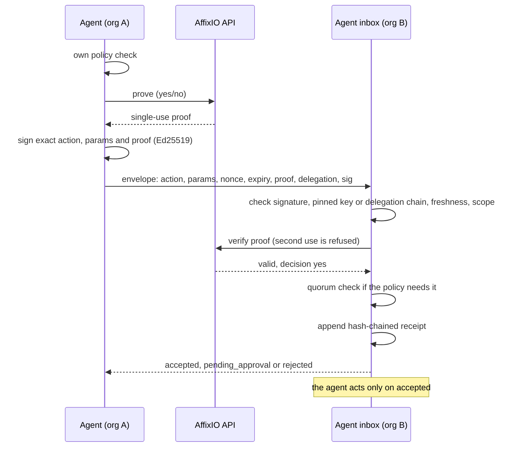

# AffixIO Agent Relay

[](LICENSE)
[](package.json)
[](tsconfig.json)
[](#use-it-from-an-mcp-client)
[](#development)

**Zero-trust authorisation for AI agents that talk to other organisations' agents: an agent checks a signed, single-use proof before it acts on a request.**

Requests between AI agents in different organisations, where every request carries a single-use [AffixIO](https://www.affix-io.com) proof and nothing is trusted by default. Ships as a TypeScript library, an HTTP inbox and an MCP server, so Claude, Cursor, Grok, Codex and other MCP clients can send, receive and approve requests.

## Why, in 30 seconds

Most agent-to-agent tooling assumes the agents already trust each other, for example because they belong to one team. Across organisations that assumption does not hold. A purchasing agent at one company and a sales agent at another have no shared login, no shared directory and no reason to take each other's word for anything.

Agent Relay treats every incoming request as untrusted until it proves otherwise, and keeps a record of why it was accepted. Try it locally with no key (the mock proves nothing, it just shows the flow):

```sh
git clone https://github.com/AffixIO/affixio-agent-relay.git && cd affixio-agent-relay
npm ci && npm run example
```

```text
Using the in-memory mock (set AFFIXIO_API_KEY for live proofs)
first delivery: { status: 'accepted', id: '3303...', digest: 'sha256:f85e...' }
replayed:       { status: 'rejected', id: '3303...', digest: 'sha256:f85e...', reason: 'replay' }
receipt log:    { ok: true, count: 3, head: 'acad216d...' }
```

Acme's owner delegates "place orders up to 40 GBP" to its buying agent, the buying agent sends a signed order to Globex's sales agent, Globex accepts it once and refuses the replay, and every decision lands in a hash-chained receipt log.

## How it works



Before an agent acts on a request from another company's agent, it checks:

- the request is signed by a key it has pinned, or by an agent holding a delegation chain back to a human or organisation key it trusts;
- the signature covers the exact action and parameters, so nothing was changed on the way;
- the request is fresh (nonce and expiry) and has not been seen before;
- the attached AffixIO proof verifies, says "yes", and has not been used before (AffixIO refuses a second verification);
- the action is inside every scope in the delegation chain, including spend limits;
- if the action needs group sign-off, enough of the listed approvers have approved it.

Every decision is written to an append-only, hash-chained receipt log that can be checked later and checkpointed against the AffixIO Merkle audit tree.

## Features

- **Proof-carrying requests.** Each envelope is signed with Ed25519 over the exact action and parameters and carries a single-use AffixIO proof.
- **Replay protection.** Nonces, expiry, and AffixIO's refusal to verify a proof twice.
- **Delegation chains.** A human or organisation key hands a scoped slice of authority (actions, per-request and running spend limits, currency, expiry) to an agent, which can narrow it further for another agent.
- **N-of-M quorum.** Risky actions wait until enough listed approvers have signed approvals, each with its own proof.
- **Tamper-evident receipts.** Append-only, hash-chained log, anchored to the AffixIO Merkle tree on demand.
- **HTTP inbox.** A small JSON API for receiving requests and approvals.
- **MCP server (stdio, 8 tools).** Lets an AI agent send, receive, verify, approve and delegate. Trust settings stay in files a person edits, not in tools a prompt can call.
- **TypeScript library.** Use the relay directly in your own service.

## Compared with plain agent messaging

| | Plain agent messaging | Agent Relay |
| --- | --- | --- |
| Who can send | Anyone who can reach the endpoint or holds a shared token | Pinned keys, or agents holding a delegation chain back to a trusted root |
| Message integrity | Depends on the transport | Ed25519 signature over the exact action and parameters |
| Replays | Usually up to the application | Nonce, expiry and single-use proof; replays are rejected |
| Delegated authority | Shared credentials | Signed, narrowing grants with spend limits and expiry |
| Group sign-off | Built by hand | N-of-M quorum in policy |
| Audit trail | Application logs | Hash-chained receipts, anchorable to a Merkle root |
| Who controls trust | Often the agent's own configuration or prompt | Files a person edits; not exposed as MCP tools |

## Status

Version 0.1. The envelope format is versioned (`agent-relay/1`) and may change before 1.0. It has not had an external security review.

## Quickstart

You need Node.js 22 or later and an AffixIO API key. Keys come from [AffixIO Studio](https://www.affix-io.com/studio): people get 100 free proofs and AI agents get 150, with no card needed.

```sh
git clone https://github.com/AffixIO/affixio-agent-relay.git
cd affixio-agent-relay
npm ci
npm run build
npm run example                         # in-memory mock, no key needed
AFFIXIO_API_KEY=your-key npm run example  # live, uses 2 proofs
```

### Run an agent

```sh
# 1. Create an identity (writes .agent-relay/identity.json, mode 600)
node dist/src/cli.js init --id globex.example/sales

# 2. Edit .agent-relay/trust.json and .agent-relay/policy.json (see below)

# 3. Run the HTTP inbox
AFFIXIO_API_KEY=your-key node dist/src/cli.js serve --port 8787
```

To replace an agent's key pair, run `node dist/src/cli.js rotate`. The agent keeps its id. The old identity is saved as `.agent-relay/identity.<timestamp>.json` (mode 600), and a `key.rotated` receipt records both public keys. The command prints the old and new public keys. Replace the old key with the new one in `trust.json` on each peer (and wherever this agent is a trusted root or quorum approver), then restart this agent. Delegation chains this agent holds name its old key, so they stop working; ask the issuer for new ones.

### Use it from an MCP client

The MCP server runs over stdio. Build the project first (`npm run build`), create an identity with `init`, then point your client at `dist/src/cli.js`. Use absolute paths. `--listen` is optional.

**Claude Desktop** (`claude_desktop_config.json`) and **Cursor** (`~/.cursor/mcp.json` or `.cursor/mcp.json` in a project) use the same shape:

```json
{
  "mcpServers": {
    "agent-relay": {
      "command": "node",
      "args": ["/path/to/affixio-agent-relay/dist/src/cli.js", "mcp", "--dir", "/path/to/.agent-relay", "--listen", "8787"],
      "env": { "AFFIXIO_API_KEY": "your-key" }
    }
  }
}
```

**Grok** (`~/.grok/config.toml`, or run `grok mcp add agent-relay -e AFFIXIO_API_KEY=your-key -- node /path/to/affixio-agent-relay/dist/src/cli.js mcp --dir /path/to/.agent-relay`):

```toml
[mcp_servers.agent-relay]
command = "node"
args = ["/path/to/affixio-agent-relay/dist/src/cli.js", "mcp", "--dir", "/path/to/.agent-relay", "--listen", "8787"]
env = { AFFIXIO_API_KEY = "${AFFIXIO_API_KEY}" }
```

**Codex** (`~/.codex/config.toml`):

```toml
[mcp_servers.agent-relay]
command = "node"
args = ["/path/to/affixio-agent-relay/dist/src/cli.js", "mcp", "--dir", "/path/to/.agent-relay", "--listen", "8787"]
env = { AFFIXIO_API_KEY = "your-key" }
```

Other MCP clients that can launch a stdio server work the same way. For a local trial without a key, set `AFFIXIO_MOCK=1` instead of `AFFIXIO_API_KEY`; mock proofs prove nothing.

`--listen` also hosts this agent's HTTP inbox in the same process, so `check_inbox` sees what arrives.

| Tool | What it does |
| --- | --- |
| `whoami` | This agent's id, public key, inbox URL and held grants |
| `send_request` | Sign a request, attach a fresh proof and deliver it to another agent's inbox |
| `check_inbox` | List received requests and their status. Act only on `accepted` |
| `verify_request` | Verify an envelope that arrived some other way (queue, email, file) |
| `approve` | Approve a request waiting for quorum in another inbox |
| `delegate` | Hand a narrower slice of authority to another agent |
| `import_grant` | Store a delegation chain issued to this agent |
| `receipts` | Check the receipt log (optionally against a saved head), show recent entries, optionally anchor it |

Trust settings are not exposed as MCP tools. Pinned peers, trusted roots and policy live in files that a person edits, so a prompt cannot widen what an agent accepts.

### Use it as a library

```ts
import { HttpAffixioClient, Relay, createInboxServer, HttpTransport, generateKeyPair } from 'affixio-agent-relay';

const affixio = new HttpAffixioClient({ apiKey: process.env.AFFIXIO_API_KEY! });
const buyer = new Relay({ identity: { id: 'acme.example/buyer', keys: generateKeyPair() }, affixio });

const env = await buyer.createRequest({ to: 'globex.example/sales', action: 'quote.request', params: { sku: 'WIDGET-9', qty: 12 } });
const result = await new HttpTransport().send('https://agents.globex.example', env);
// { status: 'accepted' | 'pending_approval' | 'rejected', reason?: string, ... }
```

The package is not published to npm. Install it from GitHub with `npm install github:AffixIO/affixio-agent-relay`.

## Configuration files

`trust.json`:

```json
{
  "peers": [{ "id": "acme.example/buyer", "key": "<base64url Ed25519 public key>" }],
  "roots": [{ "id": "acme.example/kris", "key": "<base64url Ed25519 public key>" }]
}
```

- `peers` may send requests directly.
- `roots` are human or organisation keys that may start delegation chains. Agents holding a valid chain from a root do not need to be listed.

`policy.json`:

```json
{
  "allowUnlistedActions": false,
  "actions": {
    "quote.request": {},
    "payment.*": { "requireDelegation": true },
    "deploy.production": {
      "quorum": { "threshold": 2, "approvers": [{ "id": "globex.example/alice", "key": "..." }, { "id": "globex.example/bob", "key": "..." }, { "id": "globex.example/carol", "key": "..." }] }
    }
  }
}
```

Action keys can be exact names, `prefix.*` patterns or `*`. The most specific match applies.

## Envelope specification (`agent-relay/1`)

```json
{
  "v": "agent-relay/1",
  "id": "5f0c1c0e-8a43-4d0f-9a43-2d8f3f9c7b1a",
  "from": { "id": "acme.example/buyer", "key": "<Ed25519 public key, base64url>" },
  "to": "globex.example/sales",
  "action": "payment.send",
  "params": { "amount": 40, "currency": "GBP" },
  "action_hash": "sha256:<hex of sha256(canonical({ action, params }))>",
  "nonce": "<16 to 128 base64url characters>",
  "iat": "2026-10-18T16:00:00.000Z",
  "exp": "2026-10-18T16:05:00.000Z",
  "proof": { "provider": "affixio", "circuit": "yesno", "id": "pf_...", "digest": "<64 hex>" },
  "delegation": [ "<grant>", "..." ],
  "sig": "<Ed25519 signature, base64url>",
  "approvals": [ "<approval>", "..." ]
}
```

- **Canonical form.** JSON with object keys sorted at every level, no whitespace, `undefined` members removed and non-finite numbers rejected.
- **Signature.** Ed25519 by `from.key` over the UTF-8 bytes of `"agent-relay/1\n" + canonical(envelope without sig and approvals)`.
- **Request digest.** `sha256:` plus the hex sha256 of `canonical(envelope without sig and approvals)`. Approvals sign this value.
- **Proof.** Obtained by the sender from `POST /v1/circuits/yesno/prove` after its own policy check. The receiver calls `POST /v1/circuits/yesno/verify` and requires `valid: true`, `decision: "yes"` and a matching `proof_digest`. A second verification returns HTTP 409 `double_spend_detected`.
- **Optional fields.** `delegation` is present only when the sender acts under delegated authority. `approvals` may be attached before delivery or posted to the inbox later.

### Delegation grant (`agent-relay-grant/1`)

```json
{
  "v": "agent-relay-grant/1",
  "id": "<uuid>",
  "issuer": { "id": "acme.example/kris", "key": "..." },
  "subject": { "id": "acme.example/agent-a", "key": "..." },
  "audience": "globex.example/sales",
  "scope": { "actions": ["payment.*"], "max_amount": 100, "max_total": 100, "currency": "GBP" },
  "nbf": "<iso time>",
  "exp": "<iso time>",
  "parent": null,
  "proof": { "provider": "affixio", "circuit": "yesno", "id": "pf_...", "digest": "..." },
  "sig": "<Ed25519 by issuer over \"agent-relay-grant/1\\n\" + canonical(grant without sig)>"
}
```

A chain is a list of grants from a root to the agent sending the request. The receiver checks that:

- the first grant is issued by a trusted root and has `parent: null`;
- each later grant has `parent` set to the sha256 digest of the previous grant (`sha256:` + hex of canonical form), and is issued by the previous grant's subject;
- every grant is signed by its issuer, is for this receiver (`audience`), is within its validity window and expires no later than its parent;
- each step narrows the scope: actions must be covered by the parent's actions, `max_amount` and `max_total` must be present and no larger when the parent sets them, and `currency` must match;
- the last grant's subject is the envelope's signer;
- the request's action and `params.amount` fall within every grant. `max_total` is a running total tracked by the receiver;
- each grant's AffixIO proof verifies. Because proofs are single use, the receiver verifies each grant once and remembers it, which is why grants are bound to one audience.

### Approval (`agent-relay-approval/1`)

```json
{
  "v": "agent-relay-approval/1",
  "request_id": "<envelope id>",
  "request": "<request digest>",
  "approver": { "id": "globex.example/alice", "key": "..." },
  "decision": "approve",
  "iat": "<iso time>",
  "proof": { "provider": "affixio", "circuit": "yesno", "id": "pf_...", "digest": "..." },
  "sig": "<Ed25519 by approver over \"agent-relay-approval/1\\n\" + canonical(approval without sig)>"
}
```

An approval counts only if the approver is listed in the receiver's policy with the same key, signs the right request digest, has not already approved, and its proof verifies. The request is accepted when the threshold is reached, and expires if `exp` passes first.

### HTTP inbox

| Method and path | Purpose |
| --- | --- |
| `GET /.well-known/agent-relay` | Agent id and public key |
| `POST /v1/requests` | Deliver an envelope. 200 accepted, 202 pending approval, 400 malformed, 403 rejected |
| `GET /v1/requests/:id` | Summary for approvers: action, `action_hash`, digest and status. Parameters are not included |
| `POST /v1/requests/:id/approvals` | Deliver an approval |
| `GET /v1/inbox` | Full inbox. Needs `Authorization: Bearer $AGENT_RELAY_INBOX_TOKEN`, disabled when unset |

Request bodies are limited to 64 KB and must be `application/json`.

### Receipts

`receipts.jsonl` holds one JSON object per line: `seq`, `ts`, `type`, `data`, `prev` and `hash`, where `hash` is the sha256 of the canonical form of the other fields and `prev` is the previous hash (64 zeros for the first). Editing, removing, inserting or reordering any line breaks verification, with one exception: cutting entries off the end leaves a shorter valid chain. To catch that, save the `count` and `head` from a check and pass them back later: `verifyReceipts(entries, { expect: { seq: count - 1, hash: head } })`, `ReceiptLog.verify({ expect })`, `relay.verifyReceipts({ expect })`, or the `receipts` tool with `expect_seq` and `expect_hash`. The check fails with reason `truncated` if the log no longer reaches that receipt, or `head_mismatch` if the receipt at that position has a different hash. The `receipts` tool will not anchor a log that fails this check. Receipts store the action hash and proof digests, not request parameters.

`anchor()` (or the `receipts` tool with `anchor: true`) appends a checkpoint pairing the current log head with the AffixIO Merkle root from `GET /v1/merkle/root`. Each proof digest in the log can be looked up with `GET /v1/merkle/proof/:digest` to show AffixIO recorded it.

## How this maps to AffixIO

This project uses only the public AffixIO REST API, with `fetch`. It does not use the AffixIO SDK.

| Feature | AffixIO calls |
| --- | --- |
| Proof on each request, grant and approval | `POST /v1/circuits/yesno/prove`, `POST /v1/circuits/yesno/verify` |
| Receipt anchoring | `GET /v1/merkle/root`, `GET /v1/merkle/proof/:digest` |

Delegation and quorum are built by composing individual yes/no proofs with signed grants and approvals. AffixIO's API schema lists delegation (`/v1/delegate/*`) and quorum gate (`/v1/gate/quorum/*`) routes, but their request formats are not published, so this version does not depend on them. A future version may use them once documented.

## Security notes and limits

Read these before relying on the relay.

- **What a proof means.** The yes/no proof shows that the sender's own policy check passed when the proof was made, and that the proof has not been used before. The circuit does not contain the action itself. The proof is tied to the action by the sender's signature over both, and by AffixIO allowing it to be verified only once. Replace the default `authorise` callback with your real checks; the default answers yes to everything.
- **Interception.** Someone who intercepts an envelope before delivery could copy its proof id into an envelope of their own, but they cannot sign as a pinned peer or a delegated agent, so the receiver rejects it. They could still spend the proof first, which blocks the real request (denial of service). Use HTTPS between organisations.
- **Who verifies.** The receiver verifies with its own AffixIO key. The live tests use one AffixIO account for both organisations; whether a proof made under one account verifies under another depends on AffixIO account settings. Check this for your deployment.
- **Proof window.** AffixIO looks up server-made proofs for 7 days. Grants must be presented to their audience, and requests delivered, within that time.
- **Keys.** `identity.json` holds the agent's private key in plain JSON with file mode 600. Keep it out of version control (the state folder includes its own `.gitignore`) and use a secrets manager in production. `agent-relay rotate` replaces the key pair and keeps the old one in a backup file, but peers do not learn about the new key automatically: each peer has to update its `trust.json`. There are no revocation lists yet; remove a key from `trust.json` to stop trusting it.
- **State.** Nonces, remembered grants and spend totals are kept in a JSON file for a single process. Running several inbox processes for one agent needs a shared store with atomic updates.
- **Spend totals** are reserved when a request is verified, including requests that later expire waiting for quorum. They are not released.
- **Clock skew.** 60 seconds by default. Incoming envelopes may live at most 15 minutes.
- **Approver view.** `GET /v1/requests/:id` shows the action and parameter hash to anyone who knows the request id. Ids are random UUIDs. Approvers who need the parameters should get them from the requester and check them against `action_hash`.
- **Receipts** detect changes inside the log. Entries cut off the end are only detected when you check against a head saved earlier (`expect`, see [Receipts](#receipts)) or an anchor; keep that saved head somewhere the log's owner cannot edit. Nothing detects the whole file being deleted by someone with file access, so anchor regularly and keep copies elsewhere if that matters.
- **MCP tools** can make outbound HTTP requests to the inbox URL they are given. Run the MCP server with the network access you are comfortable giving the agent.

See [SECURITY.md](SECURITY.md) to report a vulnerability.

## FAQ

**How do I stop an AI agent acting without permission?**
Put the decision outside the agent. With Agent Relay, the receiving agent only acts on requests the relay marks `accepted`: signed by a trusted key or a valid delegation chain, inside scope and spend limits, fresh, carrying an unused proof and, where policy says so, approved by enough people. The trust and policy files are edited by a person, not by the agent through MCP.

**What is agent-to-agent authorisation?**
It is checking that a request from one agent to another is allowed before acting on it: who sent it, on whose authority, for exactly which action, and whether it has been used before. Authentication tells you which agent is talking; authorisation tells you whether it may ask for this.

**Can I get MCP human approval for risky actions?**
Yes. Mark an action with a `quorum` in `policy.json` (for example 2 of 3 named people). The request waits as `pending_approval` until enough approvers send signed approvals, through the `approve` MCP tool or the HTTP inbox.

**Does it work across companies?**
That is the main use case. Each side runs its own inbox and its own AffixIO key, pins the other side's keys or trusts a root key, and verifies every request itself. See "Who verifies" under the security notes.

**Do I need an AffixIO account?**
For real proofs, yes. Keys come from [AffixIO Studio](https://www.affix-io.com/studio). The example and unit tests run against an in-memory mock with no key.

**Which MCP clients are supported?**
Any client that can launch a stdio MCP server, including Claude Desktop, Cursor, Grok and Codex. Configuration snippets are above.

**Is it on npm?**
No. Install from GitHub with `npm install github:AffixIO/affixio-agent-relay`.

## Development

```sh
npm ci
npm run lint
npm run typecheck
npm test                                   # unit tests, AffixIO mocked
AFFIXIO_API_KEY=your-key npm run test:live # live tests, about 10 proofs
```

## Licence

Apache License 2.0. See [LICENSE](LICENSE). This licence covers the code in this repository only. Use of the AffixIO API is subject to AffixIO's own terms.

## Contributing

Issues and pull requests are welcome. See [CONTRIBUTING.md](CONTRIBUTING.md) and the [good first issues](https://github.com/AffixIO/affixio-agent-relay/labels/good%20first%20issue).

If this project is useful to you, a star helps other people find it.
